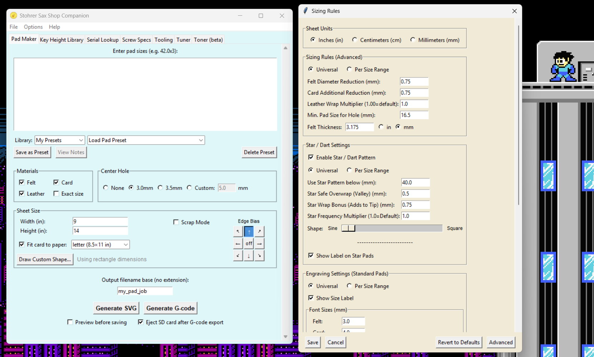
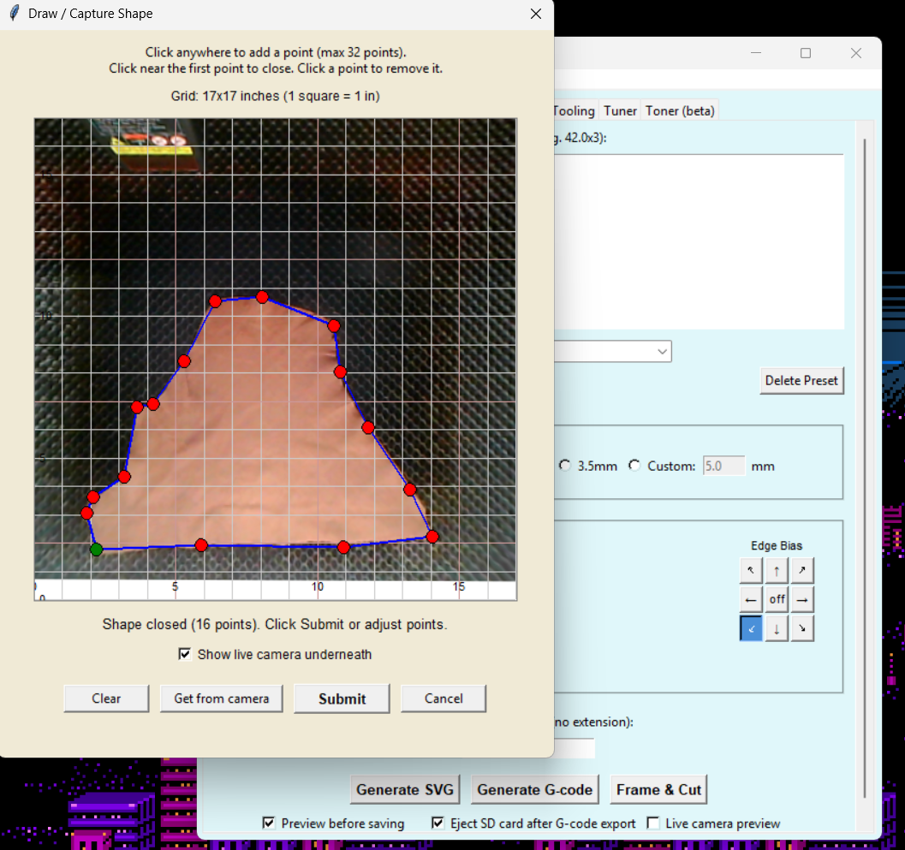

# Stohrer Sax Shop Companion

A desktop app for saxophone repair shops, by [Matt Stohrer](https://www.StohrerMusic.com). It makes the laser files for pads built by the [Phil Noy](https://noysaxophonesupplies.com) method and the tooling to assemble them, and it can run the laser itself. Windows or Linux is preferred; macOS should work.

New to making pads? Start with [How to Make Saxophone Pads](https://www.stohrermusic.com/articles/how-to-make-saxophone-pads/).

## Pad Maker



Type a list of pad sizes; get the felt, card and leather for each, nested on your material.

**Three ways to the laser**
- **G-code** to an SD card, with speed, power and passes per material. No other software needed.
- **SVG** for LightBurn, one color layer per operation.
- **Direct machine control (GRBL)** over USB with Frame & Cut: jog to the corner, frame at low power, cut. (Details below.)

**Sizing**
- Customizable sizing rules for felt, card and leather wrap, for all sizes or per size range.
- Dart option for leather cuts, with adjustable shape, count and overwrap.
- Center hole: none, 3.0 mm, 3.5 mm or custom.
- Save the whole rule set as a preset and share it. Matt's own is [`presets/Matt mode.json`](presets/Matt%20mode.json).
- Live preview of one pad's three discs as you change the rules.

**Nesting**
- Packs discs tightly on a sheet, or inside a shape you trace for a skin or offcut.
- Edge bias: push the nest toward any edge or corner.
- Scrap Mode: spread one pad list over several pieces, tracking what is left.
- `18.0 x max` fills the rest of the material with one size.
- Preview the nest before anything is written.

**Labels**
- Each disc is engraved with its size, in line or filled lettering, placed where you choose.
- Labeled Zones (opt-in): small pads cut in blocks with the size engraved on the waste beside them.
- Locator marks (opt-in): engraved guides on leather for centering pads with no hole.

**Also**
- Adhesive rings (beta, opt-in): a ring of double-sided tape per pad, for silicone wraps.
- Kerf compensation, air assist per step, cut order by layer or by pad.
- Pad lists saved in libraries; import Matt's sets from [stohrermusic.com](https://www.stohrermusic.com/articles/pad-sets-library/).
- Job History: every job written or cut, reloadable.

### Direct machine control (GRBL, opt-in)



Turn it on in File > Feature Set. Tested on a Creality Falcon2 Pro 40W; other Grbl lasers should work. Plug the laser in before or after starting the app.

- **Frame & Cut** on the Pad Maker and on every Tooling tool that makes G-code, with pause, resume and stop.
- **Camera** (optional, after a one-time calibration): capture a scrap's outline automatically, or trace it over the live image.
- **Machine menu**: home, test connection, clear errors, reset, framing power per material.

## Tooling

Every tool here can be cut straight from the app, as G-code or with Frame & Cut.

- **Die Inserts**: acrylic rings for each pad size (50 mm for pads to 39.5, 70 mm from 40). Single sizes, ranges or full sets; Scrap Mode for several sheets.
- **Die Holders**: the 85 mm stack the dies sit in. 5 or 6 layers; small, large or both.
- **Die Organizer**: a stacking rack for a full die set.
- **Kerf Test**: three circles to measure your kerf on any material.
- **Speed & Power Test** (beta): a sheet of numbered test discs across a range of settings, with a legend.
- **Tonehole Crescent**: crescents that cover part of a tonehole to flatten a note. Cork by default; also SVG and 3D-printable STL.
- **Pad Press Spacers**: 3D-printable spacers for setting press depth.

Materials: acrylic, basswood and cork, each with its own saved laser settings.

The die inserts and holders follow Phil Noy's method, which he shares freely. Each is engraved with his name.

## Everything else

- **Key Height Library**: record key heights by instrument; import Matt's from [stohrermusic.com](https://www.stohrermusic.com/articles/key-heights-library/).
- **Serial Lookup**: year of manufacture by maker and serial number.
- **Screw Specs**: thread specs by model; import Matt's from [stohrermusic.com](https://www.stohrermusic.com/articles/screw-specs-library/).
- **Strobe Tuner**: 12-wheel chromatic strobe, transposing, 60 to 120 fps.
- **Tone Analyzer** (beta): measures the harmonics of your sound and compares setups over time. Needs a good microphone.
- **In the app**: a searchable User Guide with figures, a one-page Quick Start Guide, English, Spanish, German, French and Italian, import and export of every library.

## Install

Download the latest build from [Releases](https://github.com/stohrermusic/Stohrer-Sax-Shop-Companion/releases).

**Windows**: run the installer.

**macOS**: should work, but Matt doesn't have a Mac for testing. Two builds. Apple Silicon has everything. Intel has everything except the Tuner, Tone Analyzer and direct machine control.

<details>
<summary>macOS install steps (complicated because Mac makes it hard if you don't want to pay them $100 a year to be a "developer")</summary>

1. Unzip, and drag `SaxShopCompanion.app` to **Applications**.
2. In Terminal, run:
   ```
   xattr -cr /Applications/SaxShopCompanion.app
   ```
3. Open it normally. Allow microphone access when the Tuner or Tone Analyzer asks (and camera access for the camera features).

If an older version never asked for microphone access, clear the old refusal and relaunch:
```
tccutil reset Microphone com.stohrer.saxshopcompanion
tccutil reset Camera com.stohrer.saxshopcompanion
```

</details>

**Linux**: the audio tabs need PortAudio: `sudo apt install libportaudio2`.

**From source** (Python 3.11+):
```bash
pip install -r requirements.txt
python main.py
```

## Settings location

- **Windows**: `%APPDATA%\StohrerSaxShopCompanion\`
- **macOS**: `~/Library/Application Support/StohrerSaxShopCompanion/`
- **Linux**: `~/.config/StohrerSaxShopCompanion/`

File > Import Settings from Folder moves them between machines.

## Questions or feedback

stohrermusic@gmail.com
